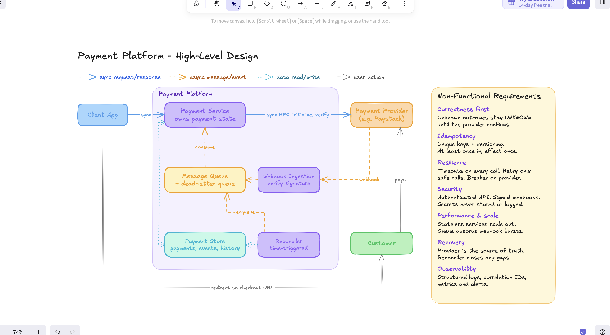

# Architecture

This is how I designed the payment service: the parts, how they talk, and why. I only mention Spring Modulith here because it shapes how events move. Other library choices are in the README.

## Diagram

## The problem

Starting a payment doesn't mean the customer has paid. When a client starts a payment, I create a checkout session with the provider and return a link. The customer pays (or doesn't) on the provider's page, and I only find out when the provider sends a webhook or when I ask. So my record is always my best guess, and most of this design is about keeping that guess right when requests fail, repeat, or arrive out of order.

## Components

- **Client App**: the merchant system that starts and checks payments. It's the only caller of my API and authenticates with an API key.
- **Admin**: an operator who resolves payments stuck in `REQUIRES_REVIEW` through an admin endpoint.
- **Customer**: the person paying. They never call my service. They pay on the provider's checkout page.
- **Payment Provider**: Paystack. I call it to create and verify transactions, and it calls me back with webhooks.
- **Payment Service**: the core. It handles client and admin requests, calls the provider, listens for events, and is the only thing that changes a payment's status. One writer means the rules live in one place.
- **Webhook Ingestion**: receives webhooks, checks the signature, saves the event, publishes it and replies. No business logic, so it's fast.
- **Application events**: there's no separate message queue. Modules talk through Spring Modulith application events, and the Payment Service listens for them after the publishing transaction commits.
- **Reconciler**: a scheduled job that claims payments stuck too long, in small batches, and re-verifies them one at a time through the same rules as verify and webhooks.
- **Payment Store**: Postgres. It keeps payments, webhook events, every status change, and Spring Modulith's event publication log.

## How they talk

| From | To | Style | Why |
|---|---|---|---|
| Client App | Payment Service | Sync | The client needs the checkout link right away. |
| Admin | Payment Service | Sync | To resolve `REQUIRES_REVIEW` payments. |
| Payment Service | Payment Provider | Sync | I need the response straight away. |
| Payment Provider | Webhook Ingestion | Async callback | The provider pushes results, possibly more than once. |
| Webhook Ingestion | Payment Service | Application event | So I can reply to the provider fast and process the event after commit. |
| Reconciler | Payment Service | Sync call | One recheck at a time, so Paystack's rate limits are respected. |
| Payment Service | Payment Store | Claim | Stuck payments are claimed with `FOR UPDATE SKIP LOCKED`, so overlapping runs never pick the same row. |
| Payment Service | Payment Store | Read/write | It's the only writer. |
| Client App | Customer | Redirect | Sends the customer to the checkout page. |

## Events and the outbox

Spring Modulith application events run inside the app, so there's no broker to run. The catch is that a plain in-memory event is lost if the app crashes before the listener finishes.

When an event has to survive that, I use the outbox pattern on Postgres. Spring Modulith's event publication registry writes the event to a table in the same transaction as the state change. The listener runs after commit, and the entry is only marked complete when the listener succeeds. Anything left incomplete is republished when the app restarts. I use this for webhook events, since losing one means a payment's status could go stale.

## Main flows

### Starting a payment

1. The client sends email, amount, currency and its own reference.
2. I check if the reference already exists. Same details? I return the existing payment. Different details? I reject it.
3. I save the payment as `INITIALIZING` before calling the provider, so I always have something to reconcile.
4. I call the provider. If it works, the payment becomes `PENDING` and I return the link. If it times out, I mark it `UNKNOWN` and don't retry blindly.

### Receiving a webhook

1. The provider sends an event.
2. I check the signature against the raw body and reject anything that fails.
3. In one transaction, I save the webhook event and publish an application event. The outbox entry is written in the same transaction. Then I reply 200. If the transaction fails, I reply with an error so the provider tries again.
4. After commit, the Payment Service listener skips events it's already seen, finds the payment, confirms with the provider, checks amount and currency, and updates the status if the change is allowed.

### Verifying a payment

1. The client asks for a payment's status by reference.
2. If it's already final, I return what I have.
3. If not, I ask the provider and read the transaction status. A 200 alone doesn't mean the customer paid.
4. I compare amount, currency and reference before changing anything.

### Reconciliation

1. On a schedule, I claim a batch of `INITIALIZING`, `PENDING` or `UNKNOWN` payments that haven't changed for longer than a threshold. Claiming uses `FOR UPDATE SKIP LOCKED` and stamps each row, so a second instance or the next run doesn't take the same ones.
2. I verify them with Paystack one at a time and apply the answer with the same rules as verify and webhooks. If Paystack is unavailable, I stop and leave the rest for the next run.
3. A stuck `INITIALIZING` payment that Paystack never heard of becomes `FAILED`. One Paystack did create moves to `PENDING` and then follows Paystack's status.
4. Anything still unresolved after the final cutoff becomes `EXPIRED`.

I chose a plain sequential job over one event per payment: it respects rate limits without extra machinery, and if it crashes, unprocessed payments are still stuck, so the next run picks them up.

### Resolving a review

1. An admin finds payments waiting for a decision with `GET /api/v1/payments?status=REQUIRES_REVIEW`, and sees why each one went into review with `GET /api/v1/admin/payments/{transactionId}/transitions`.
2. They call `POST /api/v1/admin/payments/{transactionId}/resolution` with the outcome (`SUCCESS` or `FAILED`) and a reason.
3. I check the payment is in `REQUIRES_REVIEW`, apply the change, and record who made it (the admin key's owner) and why in the status history. The database refuses an admin step that has no actor or reason.
4. If two admins decide at the same moment, optimistic locking lets the first one win, and the second gets a 409.

## Payment states

| State | Meaning | Final? |
|---|---|---|
| `INITIALIZING` | Saved, provider hasn't confirmed yet | No |
| `PENDING` | Checkout created, waiting on the customer | No |
| `UNKNOWN` | I lost the provider's response | No |
| `REQUIRES_REVIEW` | Provider data doesn't match mine | No, an admin resolves it |
| `SUCCESS` | Provider confirmed payment | Yes |
| `FAILED` | Payment failed or was never created | Yes |
| `EXPIRED` | Never resolved before the cutoff | Yes |

Allowed moves:

- `INITIALIZING` → `PENDING`, `UNKNOWN`, `FAILED`
- `PENDING` / `UNKNOWN` → `SUCCESS`, `FAILED`, `EXPIRED`, `REQUIRES_REVIEW` (and `UNKNOWN` → `PENDING`)
- `REQUIRES_REVIEW` → `SUCCESS` or `FAILED`, only through the admin endpoint
- Final states never change. A late "failed" can't undo a success.

## Design decisions

- **One writer.** Every status change goes through the Payment Service, whatever triggered it.
- **Save, then call.** I write the payment before calling the provider, so a crash never leaves a payment I don't know about.
- **No transaction open during a network call.** I save, commit, call, then update in a new transaction. Holding locks during a slow call ties up connections.
- **Events instead of a queue.** Spring Modulith application events keep everything in one app with no broker to run. The Postgres outbox covers the events I can't afford to lose.
- **Duplicates have no effect.** Webhooks can repeat and outbox entries can be resubmitted. Each event has a dedup key with a unique constraint, and payment rows use optimistic locking.
- **I don't trust webhooks alone.** Even with a valid signature, I confirm success with the provider before marking a payment paid.
- **The provider wins.** If we disagree, I go with the provider.
- **Only retry what's safe.** Retrying a read is harmless. Retrying a write that might have gone through isn't.

| Call | Failure | Retry? |
|---|---|---|
| Verify | Timeout, connection failure, 429, 500, 502, 503, 504, malformed body | Yes, with backoff |
| Initialize | 429, 503, connection refused | Yes, with backoff (never processed) |
| Initialize | Timeout, 500, other 5xx | No. Mark `UNKNOWN`, verify later |
| Any | 400, 401 | No. It'll fail again |
| Any | Circuit breaker open | No. Fail fast |

Up to 3 attempts with exponential backoff and jitter. If Paystack sends `Retry-After`, I wait that long instead, up to a cap.

## When things go wrong

| Problem | What I do |
|---|---|
| Provider times out on initialize | Mark `UNKNOWN`. A verify or the Reconciler sorts it out. |
| Provider returns 400 or 401 | Return a clear error and log it without secrets. |
| Provider is rate limiting or down | Back off on safe calls. The circuit breaker stops me piling on. |
| Same request sent twice | Return the existing payment. |
| Two identical requests at once | The unique constraint lets one through. The other gets the existing result. |
| Duplicate webhook | Acknowledge it and do nothing. |
| Webhook out of order | Final states don't change, so I record it and ignore it. |
| Customer charged but my DB write failed | Reply with an error so the provider retries. If that fails too, the Reconciler catches it. |
| App crashes before a listener finishes | The outbox entry stays incomplete and gets resubmitted. |
| Event keeps failing | It stays incomplete in the outbox table and I alert on it. |

## Non-functional requirements

- **Correctness.** If I don't know the outcome, I say so. I don't guess.
- **Idempotency.** Unique keys and versioning make repeats safe. The same purchase sent again under a new reference within a short window is refused and pointed at the existing payment.
- **Resilience.** Every outbound call has a timeout, only safe calls retry, there's a circuit breaker, and important events go through the outbox.
- **Security.** API key auth for clients, separate keys with the admin role for the admin endpoint, signed webhooks. API keys are stored hashed. Secrets live in env config and never in code, logs or responses. No card data stored.
- **Performance.** Reads under 200ms at p95. Webhooks acknowledged under 500ms.
- **Scalability.** The service is stateless, so I can add instances. The database keeps them consistent.
- **Recovery.** The Reconciler runs every 15 minutes and expires payments after 24 hours. Incomplete outbox entries are republished on restart.
- **Observability.** Structured logs with a correlation ID, metrics on outcomes and provider health, alerts. Personal data is masked.

The brief didn't give numbers, so I picked these as starting points.

## Assumptions

- It's one deployable app, split into Spring Modulith modules, not microservices. The scope doesn't need more.
- The client supplies the reference. That's what makes repeats safe.
- GHS only (configurable), one provider account.
- Each API key belongs to one client. Clients see only their own payments. Admin keys see all.
- I treat Paystack's `abandoned` as still pending, since the customer can come back.
- Any amount, currency or reference mismatch goes to `REQUIRES_REVIEW`, never `SUCCESS`.
- The webhook dedup key is event type plus provider transaction ID.
- I don't handle the customer redirect after checkout.

## Open questions

1. **Outbox republishing on several instances?** The Reconciler already shares work safely through row claiming. Republishing incomplete events on restart would need a lock so only one instance does it.
2. **Should verifying a final payment still call the provider?** Decided: no. I return what I have, which is faster and avoids rate limits. The trade-off is that rare cases like reversals aren't caught.

## Out of scope

- Refunds and reversals
- Live payments (sandbox only)
- More than one provider (though it sits behind its own boundary, so I could add one)
- Customer-facing screens
- Storing card details
