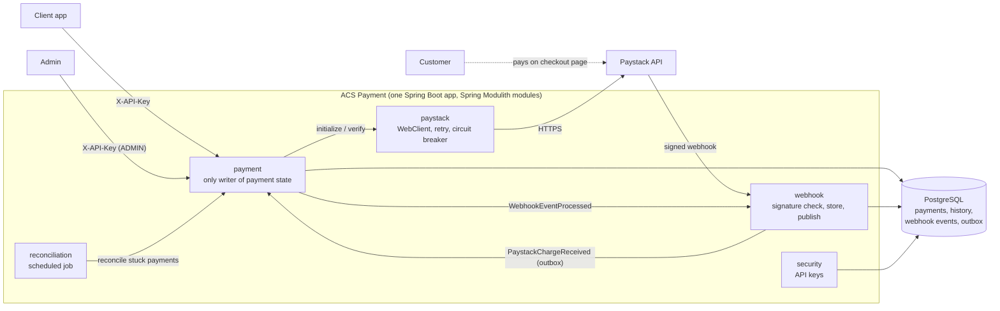

# ACS Payment

A payment service that integrates with Paystack (sandbox only). A client starts a payment and gets a checkout link. The customer pays on Paystack's page. I find out what happened through signed webhooks, by verifying with Paystack, and with a scheduled reconciler that catches anything stuck. Clients can list and look up their payments, and an admin can resolve payments whose data didn't match Paystack's.

Starting a payment is not the same as being paid, so every payment carries an honest status: `PENDING`, `UNKNOWN`, `SUCCESS`, `FAILED`, and so on. The design is about keeping that status right when requests repeat, race, time out or arrive out of order.

The full design and the reasoning behind it are in [ARCHITECTURE.md](./ARCHITECTURE.md).

## Contents

- [Quick start](#quick-start)
- [What's inside](#whats-inside)
- [Architecture](#architecture)
- [Setup](#setup)
- [Using the API](#using-the-api)
- [Sandbox walkthrough](#sandbox-walkthrough)
- [Running the tests](#running-the-tests)
- [Configuration](#configuration)
- [How it stays correct](#how-it-stays-correct)
- [Assumptions](#assumptions)
- [Trade-offs and limitations](#trade-offs-and-limitations)
- [What I'd add for production](#what-id-add-for-production)
- [Project layout](#project-layout)

## Quick start

You need Docker and a Paystack **test** secret key (see [Setup](#setup)).

```bash
cp sample.env .env
# in .env: set ACS_PAYSTACK_SECRET_KEY and ACS_SECURITY_BOOTSTRAP_ADMIN_KEY
docker compose up --build
curl localhost:8080/actuator/health        # {"groups":["liveness","readiness"],"status":"UP"}
```

That starts PostgreSQL and the app. Swagger UI is at <http://localhost:8080/swagger-ui/index.html>.

## What's inside

| Method | Path | Who | What it does |
|---|---|---|---|
| `POST` | `/api/v1/payments/initiate` | client | Starts a payment and returns Paystack's checkout link |
| `GET` | `/api/v1/payments/verify/{reference}` | client (own) / admin | Asks Paystack what happened and updates the payment |
| `GET` | `/api/v1/payments` | client (own) / admin | Lists payments: paging, sorting, status, reference and date filters |
| `GET` | `/api/v1/payments/{transactionId}` | client (own) / admin | One payment |
| `POST` | `/api/v1/webhooks/paystack` | Paystack (signed) | Receives Paystack events. No API key; checked by HMAC signature. |
| `POST` | `/api/v1/admin/api-keys` | admin | Issues an API key (shown once) |
| `DELETE` | `/api/v1/admin/api-keys/{keyId}` | admin | Revokes an API key |
| `GET` | `/api/v1/admin/payments/{transactionId}/transitions` | admin | A payment's full status history (who, what, why, when) |
| `POST` | `/api/v1/admin/payments/{transactionId}/resolution` | admin | Resolves a payment under review to `SUCCESS` or `FAILED`, with a reason |
| `GET` | `/actuator/health`, `/actuator/info` | anyone | Health |
| `GET` | `/v3/api-docs`, `/swagger-ui/index.html` | anyone | OpenAPI docs (off in `prod`) |

Clients send their key in the `X-API-Key` header. Every error is a [Problem Details](https://www.rfc-editor.org/rfc/rfc9457) body with a stable `code`, the `correlationId` and, for validation, field errors. No stack traces are ever returned.

## Architecture



| Module | Owns | May use |
|---|---|---|
| `payment` | Payments, their history, all status changes, the public payment API, admin review | `paystack`, `security`, `shared`, `webhook::events` |
| `paystack` | The Paystack client: HTTP, retries, circuit breaker, signature checks, response parsing | `shared` |
| `webhook` | The webhook endpoint, the `webhook_event` table, event types | `paystack`, `shared` |
| `reconciliation` | The schedule for rechecking stuck payments | `payment` |
| `security` | API keys, roles, the security filter chain | `shared` |
| `shared` | Clock, IDs, correlation IDs, the error handler | nothing |

The `ModularityTests` test fails the build if a module reaches into another module's internals or creates a dependency cycle.

How a payment moves:
- **Initiate:** save as `INITIALIZING` and commit, then call Paystack with no transaction open, then save the outcome (`PENDING`, `UNKNOWN` or `FAILED`) in a new short transaction.
- **Confirm:** a webhook, a verify call or the reconciler asks Paystack, compares reference, amount and currency, and applies the result through one shared writer, so the rules are the same everywhere.
- **Resolve:** anything that doesn't match goes to `REQUIRES_REVIEW` until an admin decides.

## Setup

**Prerequisites:** Java 25 and Docker. Docker runs Postgres, and the tests use Testcontainers.

**1. Get a Paystack test secret key.** In the [Paystack dashboard](https://dashboard.paystack.com), switch to **Test mode** and open **Settings → API Keys & Webhooks**. Copy the **test secret key** (`sk_test_…`). The test account needs GHS enabled. Never use a live key; the sandbox tests refuse one.

**2. Create `.env`** from the template. It's gitignored.

```bash
cp sample.env .env
```

| Variable | Required | What it's for |
|---|---|---|
| `ACS_PAYSTACK_SECRET_KEY` | yes | Calling Paystack and checking webhook signatures |
| `ACS_SECURITY_BOOTSTRAP_ADMIN_KEY` | in practice | The first admin API key, created on startup if missing. Without it nobody can issue keys. |
| `POSTGRES_USER`, `POSTGRES_PASSWORD`, `POSTGRES_PORT` | yes | The local Postgres superuser and port |
| `DB_NAME`, `DB_USERNAME`, `DB_PASSWORD`, `DB_URL` | yes | The app's database. An init script creates the user and database on first start. |
| `APP_PORT`, `APP_PROFILE` | no | Host port and Spring profile for the Docker app container (defaults `8080`, `stage`) |
| `DB_POOL_MIN_IDLE`, `DB_POOL_MAX_SIZE` | no | Connection pool size |
| `ACS_PAYSTACK_PUBLIC_KEY` | no | Not used by the service; kept for reference |

Generate a bootstrap admin key:

```bash
echo "acs_$(openssl rand -hex 6).$(openssl rand -base64 32 | tr '+/' '-_' | tr -d '=')"
```

**3. Run it**, one of two ways:

- **Everything in Docker:** `docker compose up --build`. The app runs the `stage` profile with JSON logs and Swagger on. It waits for Postgres to be healthy, and Flyway creates the schema.
- **From the IDE or Maven (dev):** `./mvnw spring-boot:run`. The `dev` profile reads `.env`, and Spring Boot's Docker Compose support starts only Postgres, from `compose.postgres.yaml`. Logs are plain text.

Both share the same Postgres container and volume.

## Using the API

With the app running and your admin key in a shell variable:

```bash
ADMIN=$(grep ^ACS_SECURITY_BOOTSTRAP_ADMIN_KEY= .env | cut -d= -f2)

# issue a client key (shown once)
KEY=$(curl -s -X POST localhost:8080/api/v1/admin/api-keys -H "X-API-Key: $ADMIN" \
  -H "Content-Type: application/json" -d '{"ownerId":"merchant-a","role":"CLIENT"}' \
  | sed -E 's/.*"apiKey":"([^"]+)".*/\1/')

# start a payment -> 201 PENDING with authorizationUrl
curl -s -X POST localhost:8080/api/v1/payments/initiate -H "X-API-Key: $KEY" \
  -H "Content-Type: application/json" \
  -d '{"email":"customer@example.com","amount":150.00,"currency":"GHS","reference":"PAY-2026-0001"}'

# same request again -> 200, same payment (safe to retry)
# same reference, different amount -> 409 payment-conflict

curl -s localhost:8080/api/v1/payments/verify/PAY-2026-0001 -H "X-API-Key: $KEY"             # 200, current status
curl -s "localhost:8080/api/v1/payments?status=PENDING&sort=amount&direction=asc" -H "X-API-Key: $KEY"
curl -s localhost:8080/api/v1/payments/<id from the list> -H "X-API-Key: $KEY"
```

A successful initiation looks like this:

```json
{
  "success": true,
  "reference": "PAY-2026-0001",
  "status": "PENDING",
  "amount": 150.00,
  "currency": "GHS",
  "authorizationUrl": "https://checkout.paystack.com/...",
  "channel": null,
  "paidAt": null,
  "message": "Payment initialized successfully"
}
```

`success` means the request worked. The `status` says whether money moved, and after initiation it never does.

**Postman:** import `postman/acs-payment.postman_collection.json` and `postman/acs-payment.local.postman_environment.json`. In the environment, set `adminKey` (your bootstrap admin key) and `paystackSecret` (your `sk_test_` key, used to sign webhook requests the way Paystack does). Run the folders in order; each saves values the next uses. All 29 requests check their own responses.

**IntelliJ HTTP Client:** copy `http/http-client.private.env.example.json` to `http/http-client.private.env.json` (gitignored), fill in the same two values, pick the `local` environment, and run `http/01` to `http/05` in order.

**Swagger UI** lists every endpoint and schema, but it can't send the `X-API-Key` header. For authenticated calls, use Postman, IntelliJ or `curl`.

## Sandbox walkthrough

### Paying for real

1. Initiate a payment (see above) and open its `authorizationUrl` in a browser.
2. Pay with one of Paystack's test cards. They're listed in Paystack's "Test Payments" docs, and that page has the current card numbers, PINs and OTPs.
3. Verify it:
   ```bash
   curl -s localhost:8080/api/v1/payments/verify/PAY-2026-0001 -H "X-API-Key: $KEY"
   # "status":"SUCCESS", with "channel" and "paidAt"
   ```
4. See how it got there:
   ```bash
   curl -s localhost:8080/api/v1/admin/payments/<id>/transitions -H "X-API-Key: $ADMIN"
   # INITIALIZING -> PENDING (INITIATE) -> SUCCESS (VERIFY)
   ```

Before paying, verify returns `PENDING`, because Paystack reports an unpaid checkout as `abandoned` and the customer can still come back.

### Receiving Paystack webhooks on your machine

Paystack has to reach your laptop over HTTPS:

1. Start a tunnel: `ngrok http 8080` (or `cloudflared tunnel --url http://localhost:8080`).
2. In the Paystack dashboard (**Test mode** → **Settings → API Keys & Webhooks**), set the **Webhook URL** to `https://<your-tunnel>/api/v1/webhooks/paystack`.
3. Create a payment and pay with a test card.
4. Paystack sends `charge.success`. I check the signature, store it, reply 200, then confirm with Paystack's verify API before marking the payment `SUCCESS`. The history shows trigger `WEBHOOK`:
   ```bash
   docker exec -it acs_payment-postgres-1 psql -U postgres -d acs_payment -c \
     "select event_type, processing_state, diagnostic from webhook_event order by received_at desc limit 5;"
   ```

### Sending a signed webhook without a tunnel

You can sign a body yourself, the same way Paystack does:

```bash
SECRET=$(grep ^ACS_PAYSTACK_SECRET_KEY= .env | cut -d= -f2)
BODY='{"event":"charge.success","data":{"id":123456789,"status":"success","reference":"PAY-2026-0001","amount":15000,"currency":"GHS"}}'
SIG=$(printf '%s' "$BODY" | openssl dgst -sha512 -hmac "$SECRET" | sed 's/^.*= //')

curl -i -X POST localhost:8080/api/v1/webhooks/paystack \
  -H "Content-Type: application/json" -H "x-paystack-signature: $SIG" --data-binary "$BODY"   # 200
```

- Sending the same body again returns 200 and is stored as `DUPLICATE`.
- Changing one character without re-signing returns 401.
- If the payment wasn't really paid, it stays `PENDING`: the event is recorded as `PROCESSED`, but Paystack's verify says unpaid, so a forged "success" never marks anything paid.
- Use `"amount":1500` to see a mismatch send the payment to `REQUIRES_REVIEW`.

### Watching reconciliation

Shorten the timings, start a payment, don't pay, and wait:

```bash
ACS_RECONCILIATION_STALE_THRESHOLD=1m ACS_RECONCILIATION_INTERVAL=20s ACS_RECONCILIATION_EXPIRY_CUTOFF=2m ./mvnw spring-boot:run
```

Within a few minutes the payment becomes `EXPIRED`, with trigger `RECONCILER` in its history.

## Running the tests

```bash
./mvnw verify
```

This needs Docker. It runs:
- unit tests (`*Test`, Surefire)
- integration tests (`*IT`, Failsafe), against a real Postgres container from Testcontainers, with Paystack stubbed by WireMock or a mocked gateway so failure cases are repeatable
- `ModularityTests`, which checks the module boundaries

Real-Paystack end-to-end tests are opt-in:

```bash
set -a; source .env; set +a      # exports ACS_PAYSTACK_SECRET_KEY
./mvnw -Psandbox verify
```

`PaystackSandboxContractE2E` checks my client against Paystack's real responses: initialize, duplicate reference, verify an unpaid transaction, unknown reference, invalid key. `PaymentLifecycleSandboxE2E` runs the whole app against the sandbox: initiate, replay, verify, a forged webhook that real verify refuses, and reconciliation to `EXPIRED`. They refuse any key that isn't `sk_test_`.

| What the brief asks to test | Where |
|---|---|
| Valid and invalid initiation; smallest-unit conversion | `PaymentInitiationIT`, `MoneyTest`, `PaymentInitiationWireIT` |
| Provider success, failure, malformed response, timeout | `PaystackHttpGatewayIT` (asserts request counts per retry rule), `PaymentInitiationIT`, `PaymentVerificationIT` |
| Repeated initiation and concurrent duplicates | `PaymentInitiationIT` (replay, conflict, 10-thread races) |
| Mismatched reference, amount, currency | `PaymentVerificationIT`, `PaystackWebhookIT` |
| Webhook signatures, replay, out-of-order | `PaystackWebhookServiceTest`, `PaystackWebhookIT`, `WebhookEventRepositoryIT` |
| Persistence, allowed transitions, access control | `PaymentRepositoryIT`, `PaymentStatusTest`, `PaymentTest`, `ApiKeyAuthenticationIT`, `PaymentQueryIT`, `PaymentReviewIT` |
| Reconciliation and expiry | `PaymentReconciliationIT` |
| End to end against the sandbox | `PaystackSandboxContractE2E`, `PaymentLifecycleSandboxE2E` |

## Configuration

| Profile | Used for | Differences |
|---|---|---|
| `dev` | Local runs | Reads `.env`, starts Postgres via Docker Compose, plain logs, SQL debug logging |
| `stage` | The Docker app container | Database from env vars, JSON (ECS) logs, Swagger on |
| `prod` | Production | Like `stage`, plus a bigger connection pool and Swagger/OpenAPI off |

Every setting can be overridden with an environment variable, for example `acs.reconciliation.interval` becomes `ACS_RECONCILIATION_INTERVAL`.

| Setting | Default | Meaning |
|---|---|---|
| `acs.paystack.connect-timeout` / `response-timeout` | `2s` / `10s` | Explicit HTTP timeouts |
| `acs.paystack.retry.max-attempts` | `3` | Attempts for calls that are safe to retry |
| `acs.paystack.retry.initial-backoff` | `500ms` | First backoff; doubles each time, with jitter |
| `acs.paystack.retry.max-retry-after` | `5s` | Longest `Retry-After` I'll honour |
| `acs.payment.supported-currencies` | `GHS` | Currency allow-list |
| `acs.reconciliation.enabled` | `true` | Turns the scheduled reconciler on or off |
| `acs.reconciliation.interval` | `15m` | Pause between reconciler runs |
| `acs.reconciliation.stale-threshold` | `15m` | How long a payment sits untouched before it's rechecked |
| `acs.reconciliation.expiry-cutoff` | `24h` | When unresolved payments expire (must be longer than the threshold) |
| `acs.reconciliation.batch-size` | `100` | Maximum payments per run |

## How it stays correct

More detail on all of this is in [ARCHITECTURE.md](./ARCHITECTURE.md).

**Payment states.** Allowed changes are defined once, in `PaymentStatus`. Final states never change, so a late "failed" can't undo a success.

| From | Can move to |
|---|---|
| `INITIALIZING` | `PENDING`, `UNKNOWN`, `FAILED` |
| `PENDING` | `SUCCESS`, `FAILED`, `EXPIRED`, `REQUIRES_REVIEW` |
| `UNKNOWN` | `PENDING`, `SUCCESS`, `FAILED`, `EXPIRED`, `REQUIRES_REVIEW` |
| `REQUIRES_REVIEW` | `SUCCESS`, `FAILED` (admin only, with a reason) |
| `SUCCESS`, `FAILED`, `EXPIRED` | nothing |

Every change is written to `payment_transition` (from, to, trigger, actor, reason, time) in the same transaction as the status change.

**Idempotency.**
- **Initiation:** the client's `reference` is unique in the database. The same request again returns the existing payment (200). The same reference with different details returns 409. When requests race, the unique constraint lets exactly one through, and the others get the replay or conflict answer, never a 500.
- **Webhooks:** each delivery is stored. A partial unique index on `event:transactionId` lets one through and records the rest as `DUPLICATE`.
- **Updates:** `@Version` optimistic locking. If two updates collide, the loser reloads and applies once more, which is then a no-op.

**Transaction boundaries.**
- I save the payment and commit **before** calling Paystack, so a crash never leaves a payment I don't know about.
- No database transaction is open during an HTTP call.
- The outcome is applied in a new, short transaction.
- The webhook row and the "process this" event are committed together (Spring Modulith's event publication table is the outbox).

**Retries.** I only retry what can't cause a second charge:

| Call | Retried on | Not retried |
|---|---|---|
| Initialize (write) | 429, 503, connection refused (never processed) | Timeout and 500 (marked `UNKNOWN`, resolved later by verify or the reconciler); 400 and 401 (fail with 502) |
| Verify (read) | Timeout, connection failure, 429, 500, 502, 503, 504, malformed body | 400, 401 (502); not found is an answer, not an error |

Up to 3 attempts, with exponential backoff and jitter. `Retry-After` is honoured up to a cap. A circuit breaker wraps the retry, so when Paystack is down, calls fail fast.

**Webhook trust.** HMAC-SHA512 over the raw request bytes, compared in constant time before anything is parsed. Even then, a `charge.success` is confirmed with Paystack's verify API before the payment is marked paid. A payload whose amount or currency doesn't match goes to `REQUIRES_REVIEW`.

**Recovery.**
- A lost response becomes `UNKNOWN`, never a blind retry.
- If storing a webhook fails, Paystack gets a 5xx and resends it.
- A scheduled reconciler claims stuck `INITIALIZING`, `PENDING` and `UNKNOWN` payments with `FOR UPDATE SKIP LOCKED`, so overlapping runs or instances never take the same rows. It verifies them one at a time, which respects rate limits, and expires them after the cutoff.
- Unfinished outbox events are republished on restart.

**Security.**
- API keys are stored only as SHA-256 hashes, with `CLIENT` and `ADMIN` roles. Clients see only their own payments and get 404 for anyone else's.
- Secrets come from the environment and never appear in logs or responses.
- Every request has a correlation ID, in the response header, in error bodies and on every log line.
- Emails aren't logged.

## Assumptions

- The client supplies the payment reference. That's what makes retries safe.
- Only GHS, through a configurable allow-list. One Paystack account.
- Paystack's `abandoned` counts as still pending, because the customer can come back to the checkout.
- The webhook dedup key is the event type plus Paystack's transaction ID.
- Any reference, amount or currency mismatch goes to `REQUIRES_REVIEW`, never `SUCCESS`.
- If Paystack says a reference is a duplicate at initialize, the payment becomes `UNKNOWN`, because Paystack already has a transaction for it, and verify decides.
- Verifying a payment that's already final returns the stored result without calling Paystack.
- Clients see only their own payments. Admin keys see everything.
- The customer redirect after checkout (`callback_url`) isn't handled here.
- The brief's "payment method" is stored as `channel` (`card`, `mobile_money`, …), taken from Paystack's verify response.

## Trade-offs and limitations

- **WebClient, used blocking, on virtual threads.** The brief asks for WebClient. The app is a normal servlet app with blocking JPA, so I call `.block()`. Virtual threads make the wait cheap. `RestClient` would be the simpler fit for a blocking app. The cost here is pulling in Reactor Netty.
- **The outbox in Postgres instead of RabbitMQ and a dead-letter queue.** One less system to run, and events commit atomically with the data. The downside is that unfinished events are republished only on restart. There's no dead-letter queue, but failed webhook outcomes are recorded and the reconciler covers the payments.
- **The reconciler is a sequential job, not one event per payment.** It respects rate limits, and a crash just means the next run picks up whatever is still stuck.
- **Unpaid payments are rechecked every threshold** (about 96 Paystack calls a day each, with the defaults) until they expire. A growing backoff would cut that.
- **Reversals of a successful payment can't be represented,** because `SUCCESS` is final. Refunds and reversals are out of scope.
- **Swagger UI can't send `X-API-Key`.** Use Postman, IntelliJ or `curl` for authenticated calls.
- **The Docker image is about 676 MB,** mostly the Ubuntu-based JRE. An Alpine JRE base would shrink it.
- **No custom metrics or tracing yet.** See below.

## What I'd add for production

- **Metrics:** payments by status, `UNKNOWN` and `REQUIRES_REVIEW` counts, webhook processing results, Paystack latency and error rate, circuit breaker state. Actuator and the Prometheus endpoint are already there.
- **Alerts:** circuit breaker open, `UNKNOWN` or review counts growing, webhook `FAILED` rate, the reconciler expiring a lot, 401s from Paystack (a bad key).
- **Tracing:** OpenTelemetry, carrying the correlation ID across the API call, the async webhook listener and the Paystack calls.
- **Several instances:** the app is stateless, and the database decides races (unique constraints, optimistic locking, `SKIP LOCKED`). Republishing outbox events on restart would need a lock (for example ShedLock) so only one instance does it.
- **High webhook volume:** ingestion is one HMAC check and one insert, and processing is async. Beyond that, I'd move processing to a broker with a dead-letter queue and scale the consumers.

## Project layout

```
src/main/java/org/clement/acs_payment/
  payment/          payments, history, initiation, verification, retrieval, reconciliation, admin review
  paystack/         Paystack client (public API) and its internals
  webhook/          webhook endpoint, events (public), event storage
  reconciliation/   scheduled job
  security/         API keys and roles
  shared/           correlation IDs, errors, clock, IDs
src/main/resources/db/migration/   Flyway migrations V1 to V9
src/test/java/                     unit (*Test), integration (*IT), sandbox (*E2E) tests
postman/                           Postman collection and environment
http/                              IntelliJ HTTP Client requests
docker/postgres/init/              creates the app database user on first start
compose.yaml, compose.postgres.yaml, Dockerfile
ARCHITECTURE.md                    design, decisions and failure handling
```
